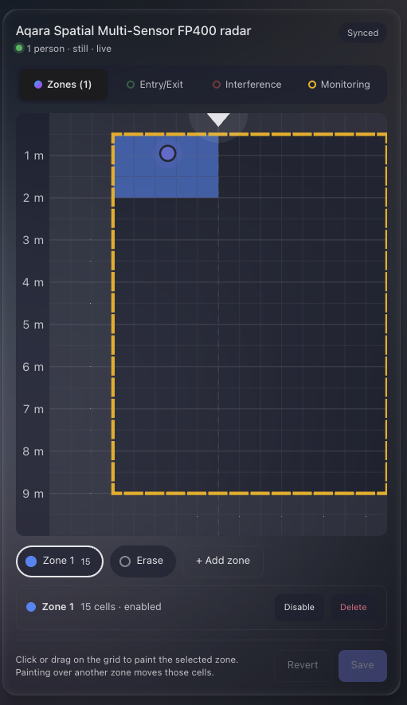
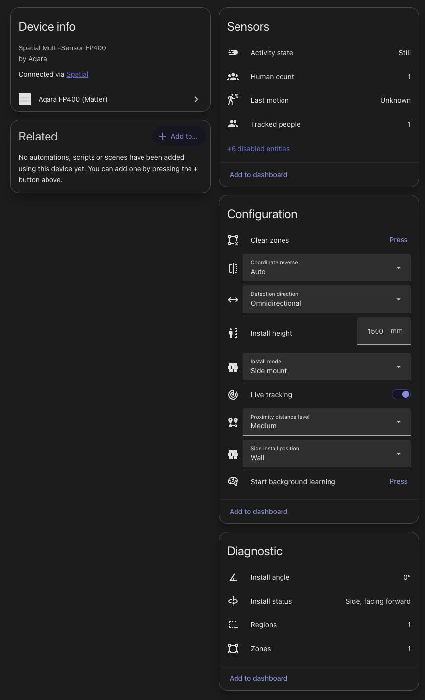

# Aqara FP400 (Matter) for Home Assistant

Zones, live people positions and setup commands for the Aqara Spatial Multi-Sensor FP400 in Matter/Thread mode —
the parts the Aqara app does (when it works) that plain Matter does not expose.

It rides on Home Assistant's Matter integration: same server connection, same fabric, no extra pairing. Entities land
on a "<device> radar" device linked to the sensor's Matter device.

Running the FP400 on Zigbee instead? This integration does not apply; see
[bobtekkk/aqara-fp400-zone-card](https://github.com/bobtekkk/aqara-fp400-zone-card) (Zigbee2MQTT converter + card).

<p align="center">
  
</p>

## Installation

1. Add `https://github.com/RAR/ha-aqara-fp400` as a custom repository in HACS (category: Integration) and install it,
   or copy `custom_components/aqara_fp400` into your `config/custom_components`.
2. Restart Home Assistant and add the **Aqara FP400 (Matter)** integration from Settings → Devices & services. It finds
   every FP400 on the Matter integration by itself.
3. Add the zone card to a dashboard (see below). The integration registers the card resource itself.

## Requirements

- Home Assistant 2026.9 or newer with the Matter integration and the FP400 commissioned.
- A Matter server that knows the FP400's vendor clusters: the [OHF Matter Server](https://github.com/matter-js/matterjs-server)
  with [#1079](https://github.com/matter-js/matterjs-server/pull/1079) (merged 2026-10-05, in releases after
  1.4.1-alpha.9). Reading works without it; zone commands and the position stream need it.
- **A Matter fabric with a vendor ID the FP400 trusts.** The device answers every explicit read, write and command on its
  vendor clusters with `UnsupportedAttribute` (status 134) when the fabric's vendor ID is 0x134B — the Nabu Casa ID the
  Home Assistant Matter Server add-on commissions with — even though it advertises the attributes. Plain occupancy and
  the scalar attributes still arrive, but zones, regions, settings writes and the position stream fail. It works from a
  fabric with the Matter test vendor ID 0xFFF1 (65521), the OHF Matter Server's default when run standalone. The add-on
  can be switched to it in its configuration (the last `--vendorid` on the command line wins; the env-var option does
  not override it):

  ```yaml
  matter_server_args:
    - "--vendorid"
    - "65521"
  ```

  A different vendor ID is a different fabric, so every Matter device on that server has to be commissioned again, not
  just the FP400. No Aqara Home setup is needed. Other vendor IDs (0x115F, Amazon, Apple) are untested.

## What you get

<p align="center">
  
</p>

| Entity | Meaning |
|---|---|
| `sensor.<name>_radar_zones` | number of zones; attribute `zones` holds `[{id, type, enabled, cells: [[row, col], …]}]` |
| `sensor.<name>_radar_regions` | number of non-empty regions; attribute `regions` holds `{entry_exit, interference, monitoring: [[row, col], …]}` |
| `sensor.<name>_radar_tracked_people` | people currently tracked; attribute `targets` = `[{id, x, y, row, col, activity, zones}]` (cm) |
| `sensor.<name>_radar_target_N_x` / `_y` | position of target N (disabled by default; enable for radar map cards) |
| `sensor.<name>_radar_last_motion` | last motion event: enter / left / left_in / right_out / right_in / left_out / access / away |
| `sensor.<name>_radar_activity_state` / `_human_count` | activity (unknown/active/still) and the device's people count |
| `sensor.<name>_radar_install_status` / `_install_angle` | orientation from the tilt sensor (diagnostic) |
| `select.<name>_radar_install_mode` / `_side_install` / `_coordinate_reverse` / `_detection_direction` / `_proximity_distance_level` | install and detection settings |
| `number.<name>_radar_install_height` | mounting height in mm (limits from the device) |
| `switch.<name>_radar_live_tracking` | keeps the position stream alive (~7 updates/s while someone moves) |
| `button.<name>_radar_start_background_learning` | starts the AI space background learning |
| `button.<name>_radar_clear_zones` | removes all zones |

Zones themselves show up through the Matter integration as extra occupancy sensors (one child endpoint per zone) after
a re-interview of the node — they are motion-triggered with the zone's own hold time.

To get rid of the integration, delete its entry (Settings → Devices & services → Aqara FP400 → ⋮ → Delete). Deleting
just the radar *device* is refused while the FP400 is still on the Matter server, since it would come back on reload.

## Services

```yaml
action: aqara_fp400.set_zones
data:
  device_id: <the FP400 device>
  zones:
    - id: 1
      cells: "3-4,6-10"        # rows 3-4, columns 6-10
    - id: 2
      cells: [[2, 8], [2, 9]]  # explicit [row, column] cells
      enabled: true
```

`aqara_fp400.clear_zones`, `aqara_fp400.subscribe_location` (timeout in seconds, max 3600) and
`aqara_fp400.start_learning` take just `device_id`. `aqara_fp400.remove_target` (`device_id`, `target_id`) makes the
sensor drop one tracked target — a ghost from a fan or curtain; a real person is picked up again within seconds. The
card does the same when you click a dot on the map; to silence a spot for good, paint it into the interference region.

Regions (the entry/exit, interference and monitoring-range areas, drawn as cell masks on the same grid) are set the
same way:

```yaml
action: aqara_fp400.set_region
data:
  device_id: <the FP400 device>
  region: entry_exit        # or: interference, monitoring
  cells: "6-7,4-6"          # rows,cols range, or explicit [[row, col], …]
```

`aqara_fp400.clear_region` takes `device_id` and `region`. Clearing the `monitoring` region means the full grid (the
device would detect nobody if the range were empty). The zone card can paint zones and all three regions —
switch layers with the buttons above the grid.

## The grid

16 columns × 20 rows of roughly 50 cm cells. Row 0 is the row nearest the sensor, column 8 is straight ahead;
columns grow as `x` decreases (column ≈ 8 − round((x + 25) / 50), row ≈ y / 50). `x`/`y` in the target attributes are
centimetres (`y` = distance from the sensor). The layout was verified by letting the device assign a person to
single-column test zones.

## Zone card

The integration serves a Lovelace card (pictured above); add it as a manual card:

```yaml
type: custom:aqara-fp400-zone-card
entity: sensor.aqara_spatial_multi_sensor_fp400_radar_zones
title: Master bedroom      # optional
sensor_at: top             # optional; top (like the Aqara app) or bottom
```

Pick a layer at the top (Zones, or one of the three regions), select a zone chip or **Add zone**, then click or drag on
the grid to paint (painting over another zone's cell moves the cell; **Erase** removes cells from any zone). The panel
under the chips enables/disables or deletes the selected zone. Regions are drawn as outlines and painted as a fill while
you edit them. **Save** writes the change to the device. Tracked people are drawn as dots (hollow when still); cells
outside the monitoring range are shaded. Turn on the live tracking switch to see people move.

## Development

Tests run inside a Home Assistant core checkout so they can reuse the Matter test fixtures:

```
ln -s $PWD/custom_components/aqara_fp400 <core>/tests/testing_config/custom_components/aqara_fp400
cp tests/test_integration.py <core>/tests/components/matter/test_zz_aqara_fp400.py
cd <core> && pytest tests/components/matter/test_zz_aqara_fp400.py
```

The `aqara_presence_fp400` node fixture referenced by the tests is part of the Home Assistant change that adds the
FP400 entities to the Matter integration.

## License

MIT, see [LICENSE](LICENSE).
