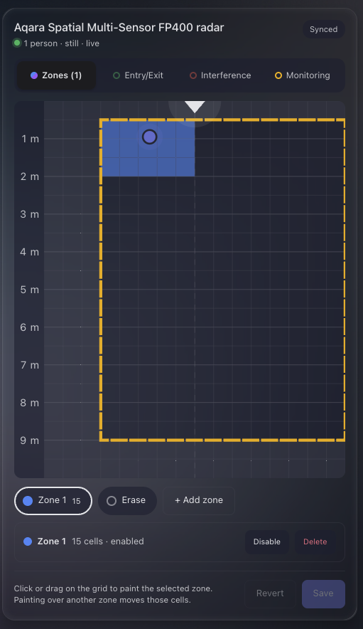
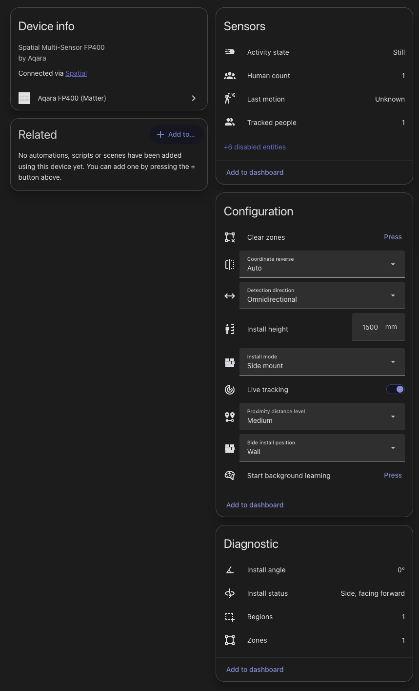

# Aqara FP400 (Matter) for Home Assistant

Zones, live people positions and setup commands for the Aqara Spatial Multi-Sensor FP400 in Matter/Thread mode —
the parts the Aqara app does (when it works) that plain Matter does not expose.

It rides on Home Assistant's Matter integration: same server connection, same fabric, no extra pairing. Entities land
on a "<device> radar" device linked to the sensor's Matter device.

Running the FP400 on Zigbee instead? This integration does not apply; see
[bobtekkk/aqara-fp400-zone-card](https://github.com/bobtekkk/aqara-fp400-zone-card) (Zigbee2MQTT converter + card).

<p align="center">
  
</p>

## Installation

1. In HACS, search for **Aqara FP400 (Matter)** and download it (it is in the default HACS catalog). If you added
   this repository as a custom repository earlier, you can remove that entry; HACS keeps the download. Without HACS,
   copy `custom_components/aqara_fp400_matter` into your `config/custom_components`.
2. Restart Home Assistant and add the **Aqara FP400 (Matter)** integration from Settings → Devices & services. It finds
   every FP400 on the Matter integration by itself.
3. Add the zone card to a dashboard (see below). The integration registers the card resource itself.

**Updating from 1.3.x:** the integration domain changed from `aqara_fp400` to `aqara_fp400_matter` in 1.4.0 (the old
name was already taken in the HACS catalog). HACS cannot update across a domain change, so remove the integration in
HACS and download it again (leave the old entry under Devices & services in place), restart, and add the
**Aqara FP400 (Matter)** integration once more: the new entry takes over the radar device, its entities (ids, names and
areas stay), the zone names and the card resource and removes the old entry. The takeover only happens while the
old `custom_components/aqara_fp400` folder still holds this integration's 1.3.x files (that is the proof the old
entry is ours; another integration uses that domain and is never touched), so keep the folder until the new entry
has loaded once. After that it is unused; delete it when convenient. Actions are now `aqara_fp400_matter.*`; update
any automations. Cards configured as `custom:aqara-fp400-zone-card` keep working.

## Requirements

- Home Assistant 2026.9 or newer with the Matter integration and the FP400 commissioned.
- A Matter server that knows the FP400's vendor clusters: the [OHF Matter Server](https://github.com/matter-js/matterjs-server)
  1.5.0 or newer (it gained them in [#1079](https://github.com/matter-js/matterjs-server/pull/1079)). The Home
  Assistant Matter Server add-on has it from version 9.3.0. Reading works without it; zone commands and the position
  stream need it, and fail on older servers with "Attribute … on cluster 291503114 unknown".
  Servers from 1.6.0 on carry Aqara's official cluster definitions ([#1269](https://github.com/matter-js/matterjs-server/pull/1269),
  [#1298](https://github.com/matter-js/matterjs-server/pull/1298)); this integration works with both (zone writes on a
  1.6.0 server need 1.3.7 or newer).
- **A Matter fabric with a vendor ID the FP400 trusts.** The device answers every explicit read, write and command on its
  vendor clusters with `UnsupportedAttribute` (status 134) when the fabric's vendor ID is 0x134B — the Nabu Casa ID the
  Home Assistant Matter Server add-on commissions with — even though it advertises the attributes. Plain occupancy and
  the scalar attributes still arrive, but zones, regions, settings writes and the position stream fail. It works from a
  fabric with the Matter test vendor ID 0xFFF1 (65521), the OHF Matter Server's default when run standalone. The add-on
  can be switched to it in its configuration (the last `--vendorid` on the command line wins; the env-var option does
  not override it):

  ```yaml
  matter_server_args:
    - "--vendorid"
    - "65521"
  ```

  A different vendor ID is a different fabric, so every Matter device on that server has to be commissioned again, not
  just the FP400. No Aqara Home setup is needed. Other vendor IDs (0x115F, Amazon, Apple) are untested. Aqara has said
  firmware 1.2.0.6 removes the vendor ID check (on [#1269](https://github.com/matter-js/matterjs-server/pull/1269));
  once that firmware is on the device, the default add-on fabric should work and this step can be skipped.

## What you get

<p align="center">
  
</p>

| Entity | Meaning |
|---|---|
| `sensor.<name>_radar_zones` | number of zones; attribute `zones` holds `[{id, name, type, proximity_detection, cells: [[row, col], …]}]`; `learning_until` / `learning_zones` while and after background learning |
| `sensor.<name>_radar_regions` | number of non-empty regions; attribute `regions` holds `{entry_exit, interference, monitoring: [[row, col], …]}` |
| `sensor.<name>_radar_tracked_people` | people currently tracked; attribute `targets` = `[{id, x, y, row, col, activity, type, posture, dynamic_points, micro_motion_points, tracking_state, zones}]` (x/y in cm; the last three are the device's tracking packet: dynamic and micro-motion point-cloud counts and a packed state); `type` is person / child / not_person / fan / pet / curtain / green_plants / sweeper / air_purifier when *AI Enhanced Person Detection* is on in the Aqara app (always person otherwise), and only persons and children are counted; `activity` is still while the dynamic point count is 0 (no noticeable movement, per Aqara); `posture` (walk / sit / stand / lie / fall / suspected_fall) is null unless the device reports one |
| `sensor.<name>_radar_target_N_x` / `_y` | position of target N (disabled by default; enable for radar map cards) |
| `sensor.<name>_radar_last_motion` | last motion event: enter / left / left_in / right_out / right_in / left_out / access / away (or `unrecognized` for a code this integration does not know yet; the code is logged); attributes `zone`, `zone_name`, `at` |
| `sensor.<name>_radar_zone_N_last_motion` | the same per zone — one sensor per configured zone, created and removed with the zones |
| `binary_sensor.<name>_radar_zone_N_occupancy` | someone is in zone N — one per configured zone, created and removed with the zones. Unlike the device's own zone occupancy (motion-triggered, drops while a person sits still) it follows the tracked people while live tracking is on (the device's zone id, or the position against the zone's cells), and the zone's enter/access and leave events otherwise; always off while the room is empty. Attributes `zone`, `zone_name`, `source` (tracking / events) |
| `sensor.<name>_radar_activity_state` / `_human_count` | activity (unknown/active/still) and the device's own people count — its estimate from the radar, reported whether or not live tracking is on; *tracked people* above is the number of targets in the position stream, so the two can differ |
| `sensor.<name>_radar_install_status` / `_install_angle` | orientation from the tilt sensor (diagnostic) |
| `select.<name>_radar_install_mode` / `_side_install_position` / `_coordinate_reverse` / `_detection_direction` / `_proximity_distance_level` | install and detection settings |
| `number.<name>_radar_install_height` | mounting height in mm (limits from the device) |
| `number.<name>_radar_zone_occupancy_off_delay` | seconds a zone occupancy sensor stays on after the last sign of someone in the zone (default 30), so a short tracker dropout or a slow leave event does not flap it |
| `switch.<name>_radar_live_tracking` | keeps the position stream alive (~7 updates/s while someone moves) |
| `button.<name>_radar_start_background_learning` | starts the AI space background learning |
| `button.<name>_radar_clear_zones` | removes all zones |

Zones themselves show up through the Matter integration as extra occupancy sensors (one child endpoint per zone) after
a re-interview of the node — they are motion-triggered with the zone's own hold time.

To get rid of the integration, delete its entry (Settings → Devices & services → Aqara FP400 → ⋮ → Delete). Deleting
just the radar *device* is refused while the FP400 is still on the Matter server, since it would come back on reload.

## Services

```yaml
action: aqara_fp400_matter.set_zones
data:
  device_id: <the FP400 device>
  zones:
    - id: 1
      cells: "3-4,6-10"        # rows 3-4, columns 6-10
    - id: 2
      cells: [[2, 8], [2, 9]]  # explicit [row, column] cells
      proximity_detection: true  # the zone's "proximity detection" setting (was `enabled` before 1.3.6)
```

`aqara_fp400_matter.clear_zones`, `aqara_fp400_matter.subscribe_location` (timeout in seconds, max 3600) and
`aqara_fp400_matter.start_learning` take just `device_id`. `aqara_fp400_matter.remove_target` (`device_id`, `target_id`) makes the
sensor drop one tracked target — a ghost from a fan or curtain; a real person is picked up again within seconds. The
card does the same when you click a dot on the map; to silence a spot for good, paint it into the interference region.

Regions (the entry/exit, interference and monitoring-range areas, drawn as cell masks on the same grid) are set the
same way:

```yaml
action: aqara_fp400_matter.set_region
data:
  device_id: <the FP400 device>
  region: entry_exit        # or: interference, monitoring
  cells: "6-7,4-6"          # rows,cols range, or explicit [[row, col], …]
```

Range specs are validated (rows 0–19, columns 0–15, no reversed ranges). Every zone and region write is read back
from the device; if the device keeps something else, the entities and the card show what the device has, with the
error in the `error` attribute and in the card's status chip on every layer.

`aqara_fp400_matter.set_zone_name` (`device_id`, `zone_id`, `name`) names a zone. The sensor has no name field, so names are
kept by Home Assistant (per sensor serial, so they survive re-pairing) and show up in the `zones` attribute, the per-zone
motion sensors and the card; an empty name clears it.

`aqara_fp400_matter.clear_region` takes `device_id` and `region`. Clearing the `monitoring` region means the full grid (the
device would detect nobody if the range were empty). The zone card can paint zones and all three regions —
switch layers with the buttons above the grid.

## The grid

16 columns × 20 rows of roughly 50 cm cells. Row 0 is the row nearest the sensor, column 8 is straight ahead;
columns grow as `x` decreases (column ≈ 8 − round((x + 25) / 50), row ≈ y / 50). `x`/`y` in the target attributes are
centimetres (`y` = distance from the sensor); `row`/`col` are derived from them. The layout was verified by letting the
device assign a person to single-column test zones.

## Zone card

The integration serves a Lovelace card (pictured above); add it as a manual card:

```yaml
type: custom:aqara-fp400-matter-zone-card
entity: sensor.aqara_spatial_multi_sensor_fp400_radar_zones
title: Master bedroom      # optional
sensor_at: top             # optional; top (like the Aqara app) or bottom
mount: wall                # optional; wall, left_corner or right_corner — defaults to the device's side-install setting
```

Corner mounts use the same cell grid; the card draws the sensor in that corner (verified on a left-corner unit, where
the cell next to the sensor is row 0, column 0; right-corner mirrors it, untested). Set the mounting in the Aqara app
or with `select.<name>_radar_side_install_position`.

Pick a layer at the top (Zones, or one of the three regions), select a zone chip or **Add zone**, then click or drag on
the grid to paint (painting over another zone's cell moves the cell; **Erase** removes cells from any zone). The panel
under the chips names, deletes or toggles proximity detection for the selected zone (that flag is what the zone
struct carries; a zone cannot be switched off — delete it instead). **Learn** runs the sensor's AI background learning
(it proposes zones itself after watching the room for about half a minute); the card counts down and reloads the zones. Regions are drawn as outlines and painted as a fill while
you edit them. **Save** writes the change to the device. Tracked people are drawn as dots (hollow when still); cells
outside the monitoring range are shaded; targets the sensor has classified as a fan, pet or other non-person are grey and
dashed. Turn on the live tracking switch to see people move.

## Development

Tests run inside a Home Assistant core checkout so they can reuse the Matter test fixtures:

```
ln -s $PWD/custom_components/aqara_fp400_matter <core>/tests/testing_config/custom_components/aqara_fp400_matter
cp tests/test_integration.py <core>/tests/components/matter/test_zz_aqara_fp400.py
cd <core> && pytest tests/components/matter/test_zz_aqara_fp400.py
```

The `aqara_presence_fp400` node fixture referenced by the tests is part of the Home Assistant change that adds the
FP400 entities to the Matter integration.

## License

MIT, see [LICENSE](LICENSE).
